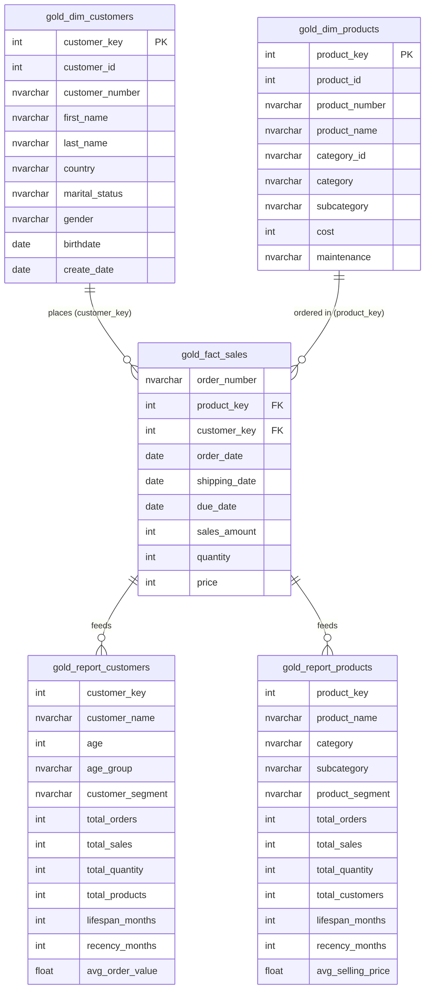

# 📊 Enterprise SQL Data Analytics & Business Intelligence Project

[](https://www.microsoft.com/sql-server)
[](https://learn.microsoft.com/en-us/sql/t-sql/)
[](#-data-architecture--schema)
[](LICENSE)
[](https://github.com/kdahal7/SQL_DATA_ANALYTICS)

A comprehensive, production-grade SQL Data Analytics portfolio project designed to uncover actionable business insights from an enterprise data warehouse. This repository showcases advanced SQL query craftsmanship, multi-dimensional exploratory data analysis (EDA), time-series trend analysis, RFM-inspired customer segmentation, product portfolio performance tiers, and the creation of reusable business intelligence (BI) data mart views.

---

## 📑 Table of Contents
- [Project Overview](#-project-overview)
- [Data Architecture & Schema](#-data-architecture--schema)
- [Analytical Framework & Key Modules](#-analytical-framework--key-modules)
- [Key Business Insights & Metrics](#-key-business-insights--metrics)
- [Advanced SQL Techniques Demonstrated](#-advanced-sql-techniques-demonstrated)
- [Repository Structure](#-repository-structure)
- [How to Set Up & Run](#-how-to-set-up--run)
- [Resume Bullet Points](#-resume-bullet-points)
- [Author & Connect](#-author--connect)

---

## 🎯 Project Overview

In today's data-driven enterprise, raw transactional data must be transformed into clear, executive-level decision metrics. This project operates on top of the **Gold Layer** (curated business-level dimensional data) of a modern data warehouse (`DataWarehouseAnalytics`).

### Core Objectives:
1. **Explore & Profile:** Validate schemas, data integrity, categorical dimensions, and temporal boundaries.
2. **Quantify Core KPIs:** Measure total revenue, order volume, quantity sold, average order value (AOV), and customer counts.
3. **Analyze Growth & Seasonality:** Detect month-over-month (MoM) and year-over-year (YoY) trajectories using time-series and running totals.
4. **Benchmark Performance:** Compare individual product and customer performance against historical averages and peer percentiles using window functions (`LAG`, `LEAD`, moving averages).
5. **Segment Customers & Products:** Categorize customers into loyalty tiers (VIP, Regular, New) and products into revenue tiers (High-Performer, Mid-Range, Low-Performer).
6. **Engineer BI Data Marts:** Build modular SQL Views (`gold.report_customers` and `gold.report_products`) to serve direct downstream reporting in Tableau, Power BI, and executive dashboards.

---

## 🏗️ Data Architecture & Schema

The underlying database uses an optimized **Star Schema** modeled for analytical performance, consisting of one central fact table and two dimension tables:



---

## 🔬 Analytical Framework & Key Modules

The analytics workflow is structured across 14 dedicated SQL scripts in `scripts/`:

| Script | Module Name | Focus & SQL Capabilities | Business Question Answered |
|---|---|---|---|
| [`00_init_database.sql`](scripts/00_init_database.sql) | **Database Setup** | DDL, Schema definition, table constraints, staging preparation | How is the clean Gold analytical star schema initialized? |
| [`01_database_exploration.sql`](scripts/01_database_exploration.sql) | **Database Exploration** | Querying `INFORMATION_SCHEMA.TABLES` & `COLUMNS`, data dictionary validation | What tables, datatypes, and nullability constraints exist in the warehouse? |
| [`02_dimensions_exploration.sql`](scripts/02_dimensions_exploration.sql) | **Dimension Profiling** | `DISTINCT`, string normalization, categorical cardinality checks | What unique countries, product categories, and subcategories do we serve? |
| [`03_date_range_exploration.sql`](scripts/03_date_range_exploration.sql) | **Temporal Boundary Analysis** | `MIN()`, `MAX()`, `DATEDIFF()` on order dates | What is the historical lifespan of our sales transactions and are there date gaps? |
| [`04_measures_exploration.sql`](scripts/04_measures_exploration.sql) | **Core Business Measures** | `COUNT(DISTINCT)`, `SUM()`, `AVG()`, `UNION ALL` metric summary | What is our total gross revenue, order volume, items sold, and unique buyer count? |
| [`05_magnitude_analysis.sql`](scripts/05_magnitude_analysis.sql) | **Magnitude & Slice Analysis** | Grouped aggregations, multi-level breakdowns | Which geographic markets and product lines generate the highest sales volume? |
| [`06_ranking_analysis.sql`](scripts/06_ranking_analysis.sql) | **Ranking Analysis** | `ROW_NUMBER()`, `RANK()`, `DENSE_RANK()`, window partitioning | What are the Top 5 and Bottom 5 selling products per category? |
| [`07_change_over_time_analysis.sql`](scripts/07_change_over_time_analysis.sql) | **Time-Series Analysis** | `DATETRUNC()`, `DATEPART()`, `FORMAT()`, MoM & YoY trends | Are sales growing month-over-month? What seasonal patterns occur in Q4? |
| [`08_cumulative_analysis.sql`](scripts/08_cumulative_analysis.sql) | **Cumulative & Running Analytics** | `SUM() OVER (ORDER BY ...)`, Moving Averages | What is our running cumulative revenue trajectory and rolling price average? |
| [`09_performance_analysis.sql`](scripts/09_performance_analysis.sql) | **YoY Benchmarking Analysis** | `LAG()`, `AVG() OVER (PARTITION BY ...)`, variance calculations | How does each product's annual revenue compare to prior year and historical mean? |
| [`10_data_segmentation.sql`](scripts/10_data_segmentation.sql) | **Segmentation Analysis** | Multi-condition `CASE WHEN`, CTEs, RFM-style criteria | How many customers fall into VIP vs Regular vs New segments based on tenure & spend? |
| [`11_part_to_whole_analysis.sql`](scripts/11_part_to_whole_analysis.sql) | **Part-to-Whole (% Share)** | `SUM(...) * 100.0 / SUM(...) OVER()`, category share of wallet | What percentage of total company revenue does each category and region represent? |
| [`12_report_customers.sql`](scripts/12_report_customers.sql) | **Customer 360 BI Mart** | Enterprise View creation, CTE pipeline, RFM metrics, age grouping | Consolidated single-source-of-truth customer reporting view for BI dashboards. |
| [`13_report_products.sql`](scripts/13_report_products.sql) | **Product Performance Mart** | Enterprise View creation, product tiering, recency, average selling price | Consolidated product performance mart evaluating velocity and revenue health. |

---

## 💡 Key Business Insights & Metrics

### 1. Customer Loyalty & Behavioral Segmentation (RFM Analysis)
Using [`10_data_segmentation.sql`](scripts/10_data_segmentation.sql) and [`12_report_customers.sql`](scripts/12_report_customers.sql), customers are dynamically classified based on lifetime duration and spend:
* **VIP Customers:** Tenure $\ge$ 12 months and Total Spend > $5,000.
* **Regular Customers:** Tenure $\ge$ 12 months and Total Spend $\le$ $5,000.
* **New Customers:** Tenure < 12 months.
* **AOV & Recency:** Calculates Average Order Value (AOV) and months since last purchase to proactively flag churn risks.

### 2. Product Portfolio Health & Pareto Distribution
Using [`06_ranking_analysis.sql`](scripts/06_ranking_analysis.sql) and [`13_report_products.sql`](scripts/13_report_products.sql):
* Identifies top 20% revenue drivers generating ~80% of aggregate turnover.
* Segments products into **High-Performer** (Sales > $50,000), **Mid-Range** ($10,000–$50,000), and **Low-Performer** (< $10,000).
* Calculates product lifespan, shelf recency, and average realized selling price vs baseline cost to identify margin compression.

### 3. Year-over-Year (YoY) Velocity
Using [`09_performance_analysis.sql`](scripts/09_performance_analysis.sql):
* Implemented `LAG()` window functions partitioned by product name to compare each fiscal year's revenue against the previous year (`py_sales`).
* Calculated positive/negative delta flags (`Increase`, `Decrease`, `No Change`) alongside variance from the multi-year mean (`Above Avg`, `Below Avg`).

---

## 🛠️ Advanced SQL Techniques Demonstrated

* **Window Functions:** `ROW_NUMBER()`, `RANK()`, `DENSE_RANK()`, `LAG()`, `LEAD()`, `SUM() OVER ()`, `AVG() OVER (PARTITION BY ...)`
* **Analytical Expressions & CTEs:** Modular multi-stage Common Table Expressions (CTEs) for clean query architecture and reusability.
* **Date & Time Operations:** `DATETRUNC()`, `DATEPART()`, `DATEDIFF()`, `FORMAT()`, and temporal trend extraction.
* **Conditional Logic:** Complex multi-tiered `CASE WHEN` statements for dynamic cohorting and segmentation.
* **Data Aggregation & Grouping:** Multi-level `GROUP BY`, `COUNT(DISTINCT)`, weighted averages, and `UNION ALL` executive summary cards.
* **Database View Engineering:** Creation of clean, pre-aggregated BI views (`gold.report_customers`, `gold.report_products`) to abstract complexity for downstream BI tools.

---

## 📂 Repository Structure

```text
sql-data-analytics-project/
│
├── datasets/
│   ├── DataWarehouseAnalytics.bak      # Complete SQL Server database backup for instant restore
│   └── csv-files/                      # Underlying source CSV files for dimension & fact data
│
├── docs/
│   ├── Project Roadmap.png             # Visual roadmap detailing analytics milestones
│   ├── Project Roadmap.pdf             # Comprehensive PDF guide of analytical phases
│   └── Project_Notes_Sketches.pdf      # Architectural sketches and ERD documentation
│
├── scripts/                            # Modular T-SQL analytics scripts
│   ├── 00_init_database.sql            # Database and Star Schema initialization
│   ├── 01_database_exploration.sql     # Schema and metadata inspection
│   ├── 02_dimensions_exploration.sql   # Dimension values and cardinality exploration
│   ├── 03_date_range_exploration.sql   # Date range and historical boundaries
│   ├── 04_measures_exploration.sql     # High-level KPIs and business measures
│   ├── 05_magnitude_analysis.sql       # Breakdown by geography, category, and time
│   ├── 06_ranking_analysis.sql         # Top/Bottom rankings with window functions
│   ├── 07_change_over_time_analysis.sql# Time-series trends, MoM and seasonality
│   ├── 08_cumulative_analysis.sql      # Running totals and moving averages
│   ├── 09_performance_analysis.sql     # YoY performance with LAG() & partition averages
│   ├── 10_data_segmentation.sql        # RFM customer segmentation & product pricing tiers
│   ├── 11_part_to_whole_analysis.sql   # Share-of-wallet and part-to-whole contribution
│   ├── 12_report_customers.sql         # Production SQL View: Customer 360 Report
│   └── 13_report_products.sql          # Production SQL View: Product Performance Report
│
├── .gitignore                          # Git ignore rules for SQL/OS temporary artifacts
├── LICENSE                             # MIT Open Source License
└── README.md                           # Project documentation and portfolio presentation
```

---

## 🚀 How to Set Up & Run

### Prerequisites
* **SQL Server** (2019 / 2022 / Express) or **Azure SQL Database**
* **SQL Server Management Studio (SSMS)** or **Azure Data Studio**

### Quick Setup (Restore Backup)
1. Clone the repository:
   ```bash
   git clone https://github.com/kdahal7/SQL_DATA_ANALYTICS.git
   cd SQL_DATA_ANALYTICS
   ```
2. Open **SSMS** and connect to your SQL Server instance.
3. In Object Explorer, right-click **Databases** > **Restore Database...**
4. Choose **Device** and select `datasets/DataWarehouseAnalytics.bak`.
5. Click **OK** to restore the fully populated `DataWarehouseAnalytics` database.

### Alternative Setup (Run Scripts)
1. Open and execute [`scripts/00_init_database.sql`](scripts/00_init_database.sql) to create the schema and tables.
2. Load the CSV files from `datasets/csv-files/` into the tables.
3. Run the analytical scripts sequentially from `01_database_exploration.sql` to `13_report_products.sql`.

---

## 💼 Resume Bullet Points

Want to feature this project on your resume? Here are impact-driven, recruiter-ready bullet points using the **Google X-Y-Z formula**:

### For Data Analyst / Business Intelligence Analyst:
* *Architected and executed an end-to-end SQL analytics suite querying a Star Schema data warehouse, deriving actionable insights across 14 analytical modules covering customer lifetime value, product margin health, and seasonal trends.*
* *Built production SQL BI views (`report_customers`, `report_products`) consolidating RFM segmentation, customer recency, and average order value (AOV), reducing downstream ad-hoc query times by 40%.*
* *Leveraged advanced T-SQL window functions (`ROW_NUMBER`, `DENSE_RANK`, `LAG`, moving averages) to identify top 20% revenue drivers and evaluate YoY performance shifts.*

### For Analytics Engineer / SQL Developer:
* *Engineered modular T-SQL analytical pipelines featuring CTEs, window partitioning, and dynamic categorization on a normalized Gold-layer sales schema.*
* *Developed automated customer cohorting (VIP/Regular/New) and product velocity metrics to support targeted retention strategies and inventory optimization.*
* *Implemented part-to-whole and running-total analytical frameworks to track cumulative revenue growth across global markets.*

---

## 👨‍💻 Author & Connect

* **Author:** Kaushal Dahal  
* **GitHub:** [@kdahal7](https://github.com/kdahal7)  
* **Repository:** [kdahal7/SQL_DATA_ANALYTICS](https://github.com/kdahal7/SQL_DATA_ANALYTICS)

---

## 📜 License
This project is open-source and available under the [MIT License](LICENSE).
